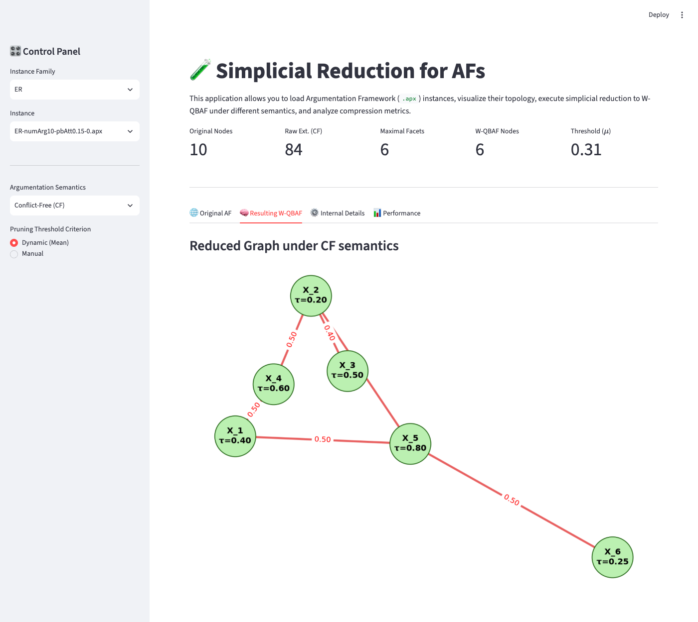

# 🧪 Simplicial Reduction for Argumentation Frameworks

[](https://simplicial-reduction-app-q3iuuseguuet5ittfdrkhi.streamlit.app)


### ▶ **[Open the app](https://simplicial-reduction-app-q3iuuseguuet5ittfdrkhi.streamlit.app)**: runs in the browser, nothing to install.

Interactive app that compresses an **abstract argumentation framework** (Dung, 1995) into a much smaller
**weighted quantitative bipolar argumentation framework (W-QBAF)**. The idea comes from topology: the conflict-free sets of
an AF form an abstract **simplicial complex**, and its **facets** (maximal simplices) are the natural building blocks of
the reduced graph.

The app loads benchmark AFs, enumerates their extensions under a chosen semantics with the SAT-based solver
[pygarg](https://github.com/jgmailly/pygarg), keeps the maximal ones as **meta-arguments**, connects them with **weighted
attacks**, and reports how much the graph shrinks.

[](https://simplicial-reduction-app-q3iuuseguuet5ittfdrkhi.streamlit.app)

*A 10-argument Erdős–Rényi AF has 84 conflict-free sets but only 6 facets: the reduced graph has 6 meta-arguments.*

## Background

An **argumentation framework** is a pair $\mathcal{A} = (\mathrm{Arg}, \mathcal{R})$ where $\mathcal{R} \subseteq
\mathrm{Arg} \times \mathrm{Arg}$ is an attack relation. A set of arguments is **conflict-free** if no member attacks
another. Every subset of a conflict-free set is conflict-free, so the conflict-free sets form an abstract simplicial
complex $\Delta_{\mathcal{A}}$ on the vertex set $\mathrm{Arg}$, the **argumentative complex**. Its facets are exactly
the **naive extensions** (maximal conflict-free sets).

The app generalises this to other semantics: it takes the extensions of the chosen semantics and keeps the ones that are
maximal by inclusion. For complete semantics these are the preferred extensions.

| Semantics | Code | Facets kept by the app |
|---|---|---|
| Conflict-free | `CF` | maximal conflict-free sets (naive extensions) |
| Complete | `CO` | maximal complete extensions (= preferred extensions) |
| Preferred | `PR` | all preferred extensions (already maximal) |
| Grounded | `GR` | the grounded extension (unique) |
| Ideal | `ID` | the ideal extension (unique) |

Empty extensions are discarded, so a semantics whose only extension is $\emptyset$ produces an empty reduced graph.

## The reduction

Given the non-empty facets $X_1, \dots, X_n$ (the meta-arguments), the app builds the W-QBAF as follows.

**1. Attack weights.** For every ordered pair $X \neq Y$, the weight is the share of members of $X$ that attack at least
one member of $Y$:

$$w(X, Y) = \frac{\lvert \lbrace x \in X : x \text{ attacks some } y \in Y \rbrace \rvert}{\lvert X \rvert}$$

Pairs with no attack get no edge.

**2. Pruning.** Only edges with $w(X,Y) \ge \mu$ are kept. The threshold $\mu$ is either the **mean of all non-zero
weights** (*Dynamic*) or a **manual** value in $[0, 1]$. Meta-arguments left without any edge are kept as **isolated**
nodes.

**3. Initial valuation.** Each connected meta-argument gets a score in $[0, 1]$ based on how it interacts with the rest of
the original AF:

$$\tau(X) = \frac{1}{2}\left(\frac{r_{\text{out}} - r_{\text{in}}}{r_{\text{out}} + r_{\text{in}}} + 1\right)$$

where $r_{\text{out}}$ counts the attacks from members of $X$ to arguments outside $X$, and $r_{\text{in}}$ counts the
attacks from outside $X$ into $X$. $\tau = 1$ means $X$ only attacks, $\tau = 0$ means it is only attacked, and
$\tau = 0.5$ is balanced. Isolated meta-arguments, and those with no external attacks, get $\tau = 0.5$.

**4. Compression.** The size of the reduced graph relative to the original is

$$\text{compression} = \frac{n}{\lvert \mathrm{Arg} \rvert},$$

where $n$ is the number of meta-arguments (connected and isolated).

Below 100 % the AF has been compressed. Above 100 % there are more facets than arguments (*combinatorial explosion*),
and 0 % means no non-empty extension survived (*structural collapse*).

## Using the app

**Sidebar**

| Control | What it does |
|---|---|
| **Instance Family** | Graph model used to generate the benchmark AFs: `ER`, `BA` or `WS` (see [Instances](#instances)). |
| **Instance** | The `.apx` file to load. |
| **Argumentation Semantics** | `CF`, `CO`, `PR`, `GR` or `ID`. |
| **Pruning Threshold Criterion** | *Dynamic (Mean)* or *Manual*, with a slider for $\mu$. |

**Results**

* **Metrics row:** number of arguments, number of extensions returned by the solver (including the empty set when it is
  one), number of maximal facets, number of W-QBAF nodes and the threshold $\mu$ applied.
* **🌐 Original AF:** the attack graph of the loaded instance.
* **🧠 Resulting W-QBAF:** meta-arguments labelled with $\tau$ and attack edges labelled with $w$.
* **⚙️ Internal Details:** the arguments inside each meta-argument (connected and isolated) and the table of kept
  weights.
* **📊 Performance:** the compression percentage with its interpretation.

Extension enumeration is exponential in the worst case. Conflict-free semantics on sparse instances with many arguments
can produce a very large number of sets, so start with the 10–30 argument instances.

## Instances

The benchmark AFs are in [pygarg/exp/instances/](pygarg/exp/instances/), in ASPARTIX (`.apx`) format: `arg(a0).` declares
an argument and `att(a0,a1).` an attack. Each family has instances with 10, 20, …, 100 arguments and several random
seeds per configuration.

| Family | Graph model | Parameters in the file name | Files |
|---|---|---|---|
| `ER` | Erdős–Rényi | `pbAtt`: attack probability, 0.15 to 0.95 | 3,230 |
| `BA` | Barabási–Albert | `pbCycle`: probability of cycles, 0 to 0.9 | 3,230 |
| `WS` | Watts–Strogatz | `pbCycle`, rewiring `beta`, `baseDegree` | 3,000 |

## Run it locally

Requires Python 3.12.

```bash
python -m venv .venv && source .venv/bin/activate
pip install -r requirements.txt     # streamlit, networkx, matplotlib, python-sat
streamlit run app.py                # opens http://localhost:8501
```

`pygarg` is included in the repository (`pygarg/src`) and `app.py` adds it to the Python path, so it does not need to be
installed separately. The SAT solvers come from `python-sat`.

## Project structure

```
├── app.py                   Streamlit app: reduction algorithm, plots and metrics
├── requirements.txt
├── docs/app.png             screenshot for this README
├── main.py                  placeholder entry point (not used by the app)
└── pygarg/                  pygarg solver (LGPL-3.0, by Jean-Guy Mailly)
    ├── src/pygarg/dung/     .apx / DIMACS parsers and SAT-based solver
    └── exp/                 benchmark instances, experiment scripts and notebooks
```

## Credits

* **pygarg**, A Python enGine for Argumentation, by Jean-Guy Mailly: <https://github.com/jgmailly/pygarg>. It is
  distributed under the GNU Lesser General Public License v3; see [pygarg/LICENSE](pygarg/LICENSE).
* P. M. Dung (1995). *On the acceptability of arguments and its fundamental role in nonmonotonic reasoning, logic
  programming and n-person games.* Artificial Intelligence 77(2), 321–357.
